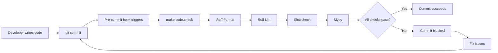

# Overview

📘 This FastAPI-based project demonstrates a practical implementation of Domain-Driven Design (DDD) principles combined with Clean Architecture and Command Query Responsibility Segregation (CQRS). The project showcases how these architectural patterns can be effectively applied in Python to build maintainable, testable, and scalable backend systems.

# Table of Contents

1. [Overview](#overview)
2. [Domain-Driven Design Approach](#domain-driven-design-approach)
   1. [Core Concepts](#core-concepts)
   2. [Layered Architecture](#layered-architecture)
   3. [CQRS Pattern](#cqrs-pattern)
3. [Project](#project)
   1. [Dependency Graphs](#dependency-graphs)
   2. [Structure](#structure)
   3. [Technology Stack](#technology-stack)
   4. [Configuration](#configuration)
      1. [Files](#files)
      2. [Flow](#flow)
      3. [Local Environment](#local-environment)
4. [Authentication & Authorization](#authentication--authorization)
   1. [Keycloak Integration](#keycloak-integration)
   2. [Module Independence](#module-independence)
   3. [Authentication Flow](#authentication-flow)
   4. [Protected Routes](#protected-routes)

# Domain-Driven Design Approach

## Core Concepts

Domain-Driven Design (DDD) is a software development approach that focuses on modeling software to match a domain according to input from domain experts. The core philosophy is to place the project's primary focus on the core domain and domain logic.

**Key DDD Principles Applied:**

- **Ubiquitous Language** — Consistent terminology shared by developers and domain experts throughout the codebase
- **Bounded Contexts** — Clear boundaries between different parts of the system (e.g., rules management)
- **Domain Model** — Rich business logic encapsulated in entities, value objects, and domain services
- **Separation of Concerns** — Business logic isolated from infrastructure and presentation concerns

## Layered Architecture

This project implements a strict layered architecture with clear dependency rules:

 **Domain Layer**

- Contains the core business logic and rules
- **Entities** — Business objects with identity and lifecycle (e.g., `Rule`, `Table`)
- **Value Objects** — Immutable objects defined by their attributes (e.g., `RuleName`, `TableName`)
- **Domain Services** — Operations that don't naturally belong to entities or value objects
- **Ports** — Interfaces that define contracts for external dependencies
- **Domain Exceptions** — Business rule violations and domain-specific errors

 **Application Layer**

- Orchestrates domain logic to fulfill use cases
- **Commands** — Write operations and business-critical reads (e.g., `CreateRuleCommand`, `UpdateRuleCommand`)
- **Queries** — Optimized read operations for data presentation (e.g., `ListRulesQuery`, `GetRuleByIdQuery`)
- **Interactors** — Stateless components that handle single business operations
- **DTOs** — Data Transfer Objects for cross-layer communication

 **Infrastructure Layer**

- Implements technical capabilities to support higher layers
- **Adapters** — Concrete implementations of domain ports (e.g., database repositories)
- **Persistence** — Database models, migrations, and ORM configurations
- **External Services** — Third-party API integrations

 **Presentation Layer**

- Handles external requests and responses
- **HTTP Controllers** — FastAPI route handlers
- **Request/Response Models** — Pydantic models for API contracts
- **Error Handlers** — HTTP error mapping and formatting

**Dependency Rule:**

> Dependencies must point inward. Inner layers must never depend on outer layers.

This ensures that business logic remains independent of frameworks, databases, and other external concerns.

## CQRS Pattern

The project implements Command Query Responsibility Segregation (CQRS) to separate read and write operations:

- **Commands** handle write operations through interactors that work with full domain entities
- **Queries** provide optimized read paths using specialized query models
- This separation enables:
  - Performance optimization for reads
  - Clear separation of concerns
  - Flexibility to scale reads and writes independently

# Project

## Dependency Graphs

The project follows a modular structure where each module (e.g., `rules`) contains its own layered architecture:

```
Module (e.g., rules)
├── Domain Layer (entities, value objects, ports)
├── Application Layer (commands, queries)
├── Infrastructure Layer (adapters, persistence)
└── Presentation Layer (HTTP controllers)
```

**Key Dependency Flows:**

1. **Controller → Interactor**: Presentation layer calls application layer
2. **Interactor → Domain**: Application layer orchestrates domain logic
3. **Interactor → Adapter**: Application layer uses infrastructure through ports
4. **Adapter → Domain**: Infrastructure implements domain ports

## Structure

```
.
├── config/                                      # configuration files and Docker setup
│   ├── local/                                   # local environment config
│   │   ├── config.toml                          # main settings
│   │   ├── .secrets.toml                        # sensitive data (not in VCS)
│   │   ├── export.toml                          # env export configuration
│   │   └── docker-compose.yaml                  # Docker Compose setup
│   ├── dev/                                     # development environment
│   ├── prod/                                    # production environment
│   └── toml_config_manager.py                   # config management script
├── scripts/                                     # helper scripts
├── Makefile                                     # shortcuts for common tasks
├── pyproject.toml                               # project configuration (uv)
├── alembic.ini                                  # database migration config
└── src/
    ├── app/                                     # application setup
    │   ├── run.py                               # application entry point
    │   ├── app_factory.py                       # app and DI container factory
    │   ├── provider_registry.py                 # DI provider registration
    │   ├── api_v1_router.py                     # API v1 router aggregation
    │   └── root_router.py                       # root router setup
    ├── core/                                    # shared core functionality
    │   ├── config/                              # configuration management
    │   │   ├── settings.py                      # settings loader
    │   │   ├── logs.py                          # logging configuration
    │   │   └── database/                        # database setup
    │   │       └── migrations/                  # Alembic migrations
    │   └── lib/                                 # shared libraries
    │       ├── base/                            # base classes
    │       ├── db/                              # database utilities
    │       └── http/                            # HTTP utilities
    └── modules/                                 # business modules
        └── rules/                               # rules management module
            ├── domain/                          # domain layer
            │   ├── entities/                    # entities (have identity)
            │   ├── value_objects/               # value objects (no identity)
            │   ├── ports/                       # interfaces for adapters
            │   ├── enums/                       # domain enumerations
            │   └── exceptions/                  # domain exceptions
            ├── application/                     # application layer
            │   ├── commands/                    # write operations
            │   │   ├── create_rule.py           # create rule interactor
            │   │   ├── update_rule.py           # update rule interactor
            │   │   └── ...                      # other commands
            │   └── queries/                     # read operations
            │       ├── list_rules.py            # list rules query
            │       ├── get_rule_by_id.py        # get rule by ID query
            │       └── ...                      # other queries
            ├── infrastructure/                  # infrastructure layer
            │   ├── adapters/                    # port implementations
            │   └── persistence/                 # database models
            └── presentation/                    # presentation layer
                └── http/                        # HTTP interface
                    ├── controllers/             # route handlers
                    └── schemas/                 # request/response models
```

## Technology Stack

- **Python**: `3.13`
- **Web Framework**: `fastapi` — Modern, fast web framework for building APIs
- **Dependency Injection**: `dishka` — Framework-agnostic DI container
- **Database**: `PostgreSQL 16` — Relational database
- **ORM**: `sqlalchemy[mypy]` — SQL toolkit and ORM with type checking support
- **Database Driver**: `psycopg[binary]` — PostgreSQL adapter for Python
- **Migrations**: `alembic`, `alembic-postgresql-enum` — Database migration tool
- **Server**: `uvicorn`, `uvloop` — ASGI server with high-performance event loop
- **Utilities**:
  - `uuid-utils` — Fast UUID operations
  - `python-slugify[unidecode]` — URL-friendly slugs
  - `keyof` — TypeScript-like keyof for Python
  - `fastapi-error-map` — Contextual error handling
- **Development Tools**:
  - `mypy` — Static type checker
  - `ruff` — Fast Python linter and formatter
  - `slotscheck` — Validate `__slots__` usage
  - `pre-commit` — Git hooks for code quality
- **Testing**:
  - `pytest`, `pytest-asyncio` — Testing framework
  - `coverage` — Code coverage measurement
  - `httpx` — HTTP client for testing
  - `line-profiler` — Performance profiling

## Configuration

> [!WARNING]
> This configuration system is specific to this project. Use any configuration method you prefer.

### Files

- **config.toml**: Main application settings organized in sections
- **export.toml**: Lists fields to export to .env
- **.secrets.toml**: Optional sensitive data (same format as config.toml, merged with main config)

> [!IMPORTANT]
> In production, ensure that `.secrets.toml` and all `.env` files are not tracked by version control to prevent exposing sensitive information. See `.gitignore` for proper exclusion patterns.

### Flow

This project uses a TOML-based configuration system as the single source of truth. The system generates `.env` files for Docker and infrastructure components while the application reads settings directly from structured TOML files.

**Configuration Flow:**

1. Edit TOML files in `config/{environment}/`
2. Run `make dotenv` to generate `.env.{environment}`
3. Docker Compose uses generated `.env` file
4. Application reads TOML files directly

### Local Environment

1. **Configure local environment**

   - Local configuration is already prepared in `config/local/`
   - Adjust TOML files if you want to change defaults
   - `.env.local` will be generated automatically — **don't** create or edit it manually

2. **Set environment variable**

   ```shell
   export APP_ENV=local
   # export APP_ENV=dev
   # export APP_ENV=prod
   ```

3. **Check environment and generate .env**

   ```shell
   make env      # should print APP_ENV=local
   make dotenv   # generates .env.local
   ```

4. **Install uv (package manager)**

   ```shell
   # Install pipx if not already installed
   # sudo apt update
   # sudo apt install pipx
   # pipx ensurepath

   # Install uv
   # pipx install uv

   # Install Python 3.13 if needed
   # uv python install 3.13
   ```

5. **Set up virtual environment**

   ```shell
   uv sync --group dev
   source .venv/bin/activate

   # Install pre-commit hooks
   pre-commit install
   ```

   Don't forget to configure your IDE to use the interpreter at `.venv/bin/python`.

6. **Launch the application**

   **Option A: Run only database in Docker, app locally**

   ```shell
   # Start database
   make up.db

   # Apply migrations
   alembic upgrade head

   # Run app through your IDE or:
   python -m app.run
   ```

   **Option B: Run everything in Docker**

   ```shell
   make up
   # Migrations are applied automatically at startup
   ```

   The API will be available at `http://localhost:8000`

7. **Shutdown**

   ```shell
   make down         # Stop containers
   make down.total   # Stop containers and remove volumes
   ```

**Additional Commands:**

```shell
# Code quality
make code.format    # Format code with ruff
make code.lint      # Run linters (ruff, slotscheck, mypy)
make code.test      # Run tests
make code.cov       # Run tests with coverage report
make code.check     # Full code quality check

# Database
make logs.db        # View database logs
make shell.db       # Access database shell

# Docker
make prune          # Clean up Docker resources
```

**Environment Variables:**

The application uses `APP_ENV` to determine which configuration to load:

- `local` — Local development
- `dev` — Development environment
- `prod` — Production environment

**Adding New Environments:**

1. Create directory in `config/{new_env}/`
2. Add configuration files: `config.toml`, `.secrets.toml`, `export.toml`
3. Optionally add `docker-compose.yaml` for Docker setup
4. Update `toml_config_manager.py` if needed

## Code Quality & Pre-commit Hooks

This project enforces strict code quality standards through automated checks that run before each commit.

### Pre-commit Hook Configuration

The project uses **pre-commit** to automatically run code quality checks before allowing commits. The configuration is defined in `.pre-commit-config.yaml`:

```yaml
repos:
  - repo: local
    hooks:
      - id: make-check
        name: source-code-check
        entry: make code.check
        language: system
        pass_filenames: false
        always_run: true
```

**How it works:**

1. When you run `git commit`, the pre-commit hook automatically triggers
2. It executes `make code.check` which runs all quality checks
3. If any check fails, the commit is blocked until issues are fixed
4. This ensures that only high-quality, properly formatted code enters the repository

### Code Quality Tools

The project uses multiple tools to maintain code quality, each serving a specific purpose:

#### 1. **Ruff** — Fast Python Linter & Formatter

**Purpose:** Code formatting and linting

**What it does:**

- **Formatting**: Automatically formats code to follow consistent style (line length, indentation, quotes, etc.)
- **Linting**: Detects code smells, potential bugs, and style violations
- **Speed**: Extremely fast (10-100x faster than traditional tools like flake8/black)

**Rules enforced:**

- `pycodestyle` (E, W) — PEP 8 style guide compliance
- `pyflakes` (F) — Logical errors and unused imports
- `isort` (I) — Import statement organization
- `flake8-bugbear` (B) — Common bug patterns
- `flake8-comprehensions` (C4) — List/dict comprehension improvements
- `pyupgrade` (UP) — Modern Python syntax upgrades
- `flake8-bandit` (S) — Security issue detection
- `pylint` (PL) — Code quality and error detection
- And many more (see `pyproject.toml` for full list)

**Commands:**

```shell
make code.format    # Auto-format all code
ruff format         # Direct ruff formatting
ruff check --fix    # Auto-fix linting issues
```

#### 2. **Mypy** — Static Type Checker

**Purpose:** Type safety and type hint validation

**What it does:**

- Verifies that type hints are correct and consistent
- Catches type-related bugs before runtime
- Ensures function signatures match their implementations
- Validates that variables are used with correct types

**Configuration:**

- **Strict mode enabled** — Maximum type safety
- **Plugins**: `pydantic.mypy`, `sqlalchemy.ext.mypy.plugin`, `keyof.mypy_plugin`
- Checks all files in `config/`, `scripts/`, and `src/`

**Example errors caught:**

```python
# Mypy catches this before runtime
def add(a: int, b: int) -> int:
    return a + b

result: str = add(1, 2)  # Error: Incompatible types
```

**Commands:**

```shell
mypy                    # Run type checking
mypy --no-incremental   # Clear cache and recheck
```

#### 3. **Slotscheck** — `__slots__` Validator

**Purpose:** Validates proper use of `__slots__` in classes

**What it does:**

- Ensures `__slots__` are correctly defined in classes
- Detects overlapping slots in inheritance hierarchies
- Verifies that all instance attributes are declared in `__slots__`
- Helps reduce memory usage and improve performance

**Why it matters:**

- `__slots__` reduces memory overhead per instance
- Prevents accidental attribute creation
- Improves attribute access speed

**Commands:**

```shell
slotscheck src    # Check slots in source code
```

#### 4. **Pytest** — Testing Framework

**Purpose:** Unit and integration testing

**What it does:**

- Runs automated tests to verify code correctness
- Supports async testing with `pytest-asyncio`
- Provides detailed failure reports
- Measures code coverage

**Test organization:**

```
tests/
└── modules/
    └── rules/
        ├── domain/
        │   └── entities/
        │       └── test_rule.py
        └── presentation/
            └── http/
                └── test_create_rule.py
```

**Commands:**

```shell
make code.test       # Run all tests
pytest -v            # Verbose test output
pytest -k "test_name" # Run specific test
make code.cov        # Run tests with coverage
```

#### 5. **Coverage** — Code Coverage Measurement

**Purpose:** Measures how much code is tested

**What it does:**

- Tracks which lines of code are executed during tests
- Identifies untested code paths
- Generates coverage reports (terminal and HTML)

**Configuration:**

- Excludes `__init__.py` files and Alembic migrations
- Shows missing lines in reports
- Supports parallel test execution

**Commands:**

```shell
make code.cov        # Generate coverage report
make code.cov.html   # Generate HTML coverage report
```

### Code Quality Workflow

The complete code quality check process (`make code.check`) runs:

1. **Ruff Format** — Formats all code to consistent style
2. **Ruff Check** — Lints code and auto-fixes issues
3. **Slotscheck** — Validates `__slots__` usage
4. **Mypy** — Performs static type checking

**Workflow:**



### Benefits of This Approach

1. **Consistency** — All code follows the same style and conventions
2. **Early Bug Detection** — Catches errors before they reach production
3. **Type Safety** — Prevents type-related bugs through static analysis
4. **Maintainability** — Clean, well-formatted code is easier to maintain
5. **Documentation** — Type hints serve as inline documentation
6. **Performance** — `__slots__` validation ensures optimal memory usage
7. **Confidence** — Automated tests verify code correctness

### Bypassing Pre-commit (Not Recommended)

In rare cases where you need to commit without running checks:

```shell
git commit --no-verify -m "message"
```

**Warning:** Only use this for emergency fixes. All code should pass quality checks before merging.

# Authentication & Authorization

This project uses **Keycloak** as the identity and access management solution, providing enterprise-grade authentication and authorization capabilities.

## Keycloak Integration

### Overview

Keycloak is an open-source Identity and Access Management (IAM) solution that provides:

- **Single Sign-On (SSO)** — Users authenticate once and access multiple applications
- **OAuth2/OpenID Connect** — Industry-standard authentication protocols
- **Role-Based Access Control (RBAC)** — Fine-grained permission management
- **User Federation** — Integration with LDAP, Active Directory, and other identity providers
- **Multi-Factor Authentication (MFA)** — Enhanced security options

### Architecture

The authentication system follows a **decoupled architecture** where the `auth` and `users` modules remain independent:

```
┌─────────────────────────────────────────────┐
│         auth/controllers/me.py              │
│  - Depends on: UserProfileService (core)    │
│  - No direct dependency on users module     │
└──────────────────┬──────────────────────────┘
                   │ FromDishka
                   ↓
┌─────────────────────────────────────────────┐
│      core/services/UserProfileService       │
│  - Uses: UserRepositoryProtocol             │
│  - Uses: KeycloakClientProtocol             │
│  - Orchestrates without concrete deps       │
└──────────────┬──────────────────┬───────────┘
               │                  │
               ↓                  ↓
┌──────────────────────┐  ┌─────────────────────┐
│  UserRepository      │  │  KeycloakClient     │
│  (users module)      │  │  (auth module)      │
│  Implements Protocol │  │  Implements Protocol│
└──────────────────────┘  └─────────────────────┘
```

**Key Principles:**

- ✅ **Module Independence** — `auth` and `users` modules don't import from each other
- ✅ **Dependency Inversion** — Both depend on abstractions (Protocols) in `core`
- ✅ **Single Responsibility** — Each module handles its own domain
- ✅ **Testability** — Protocols enable easy mocking and testing

### Configuration

Keycloak settings are managed through TOML configuration files:

**`config/local/config.toml`:**

```toml
[kc_app]
SERVER_URL = "http://keycloak:8080"
REALM = "eq_prepaid_realm"
CLIENT_ID = "eq_prepaid_backend_cli"
AUTHORIZATION_ENDPOINT = "/protocol/openid-connect/auth"
TOKEN_ENDPOINT = "/protocol/openid-connect/token"
USERINFO_ENDPOINT = "/protocol/openid-connect/userinfo"
JWKS_ENDPOINT = "/protocol/openid-connect/certs"
LOGOUT_ENDPOINT = "/protocol/openid-connect/logout"
SCOPES = "openid profile email"

[kc_admin]
USER = "admin"
PASSWORD = "admin"
```

**`config/local/.secrets.toml`:**

```toml
[kc_app]
CLIENT_SECRET = "your-client-secret"
PUBLIC_KEY = "your-rsa-public-key"
```

### Docker Setup

Keycloak runs as a Docker container alongside the application:

```yaml
# config/local/docker-compose.yaml
services:
  keycloak:
    image: quay.io/keycloak/keycloak:26.0.7
    environment:
      KC_DB: postgres
      KC_DB_URL: jdbc:postgresql://keycloak_db_pg:5432/keycloak
      KC_HOSTNAME: localhost
      KC_HTTP_PORT: 8080
      KEYCLOAK_ADMIN: ${KC_ADMIN_USER}
      KEYCLOAK_ADMIN_PASSWORD: ${KC_ADMIN_PASSWORD}
    ports:
      - "8088:8080"
    networks:
      - keycloak_net
```

**Access Keycloak Admin Console:**

- URL: http://localhost:8088
- Username: `admin`
- Password: `admin`

## Module Independence

### Service Layer Pattern

To maintain module independence, a **shared service** in `core` orchestrates interactions:

**`src/core/services/user_profile_service.py`:**

```python
class UserProfileService:
    """Service to get complete user profile."""

    def __init__(
        self,
        user_repository: UserRepositoryProtocol,
        keycloak_client: KeycloakClientProtocol,
    ) -> None:
        self.user_repository = user_repository
        self.keycloak_client = keycloak_client

    async def get_user_profile(
        self, keycloak_id: str, roles: list[str]
    ) -> UserProfileData | None:
        """Get complete user profile combining DB and Keycloak data."""
        # Get user from database
        user = await self.user_repository.find_one_by_keycloak_id(keycloak_id)

        # Get groups from Keycloak
        groups = await self.keycloak_client.get_user_groups(keycloak_id)

        # Combine and return
        return UserProfileData(...)
```

### Dependency Injection

Modules provide their implementations via **Protocols**:

**Auth Module Provider:**

```python
# src/modules/auth/auth_provider.py
@provide
def keycloak_client_protocol(
    self, client: KeycloakClient
) -> KeycloakClientProtocol:
    return client
```

**Users Module Provider:**

```python
# src/modules/users/user_provider.py
@provide
def provide_user_repository_protocol(
    self, repo: UserRepository
) -> UserRepositoryProtocol:
    return repo
```

**Service Provider:**

```python
# src/core/services/user_profile_provider.py
@provide
def provide_user_profile_service(
    self,
    user_repository: UserRepositoryProtocol,
    keycloak_client: KeycloakClientProtocol,
) -> UserProfileService:
    return UserProfileService(user_repository, keycloak_client)
```

## Authentication Flow

### 1. User Login

```bash
POST /api/v1/auth/login
Content-Type: application/json

{
  "username": "user@example.com",
  "password": "password123"
}
```

**Response:**

```json
{
  "access_token": "eyJhbGciOiJSUzI1NiIsInR5cCI6IkpXVCJ9...",
  "refresh_token": "eyJhbGciOiJIUzI1NiIsInR5cCI6IkpXVCJ9...",
  "token_type": "Bearer",
  "expires_in": 1800
}
```

**Token Details:**

- `access_token`: Valid for **30 minutes** (1800 seconds)
- `refresh_token`: Valid for **5 days** (432000 seconds)
- `expires_in`: Time in seconds until access token expires

### 2. Token Validation

The application validates JWT tokens using:

- **RSA Public Key** — Verifies token signature
- **Audience Validation** — Ensures token is for this client
- **Expiration Check** — Validates token hasn't expired
- **Claims Extraction** — Extracts user info and roles

**JWT Decoder:**

```python
# src/modules/auth/infrastructure/keycloak/jwt_decoder.py
class JWTDecoder:
    def decode_token(self, token: str) -> dict[str, Any]:
        payload = jwt.decode(
            token,
            self.public_key,
            algorithms=["RS256"],
            audience=self.keycloak.client_id,
        )
        return payload
```

### 3. Get Current User

```bash
GET /api/v1/auth/me
Authorization: Bearer <access_token>
```

**Response:**

```json
{
  "id": "550e8400-e29b-41d4-a716-446655440000",
  "name": "John Doe",
  "email": "john@example.com",
  "username": "johndoe",
  "is_active": true,
  "keycloak_id": "d48d63ac-e997-447a-ac67-eda6d67e8ed8",
  "roles": ["users_manager", "admin"],
  "groups": [
    {
      "id": "group-uuid",
      "name": "Administrators",
      "path": "/Administrators"
    }
  ]
}
```

**Data Sources:**

- `id`, `name`, `email`, `username`, `is_active` — From database (User entity)
- `keycloak_id`, `roles` — From JWT token
- `groups` — From Keycloak API

### 4. Token Refresh

```bash
POST /api/v1/auth/refresh
Content-Type: application/json

{
  "refresh_token": "eyJhbGciOiJIUzI1NiIsInR5cCI6IkpXVCJ9..."
}
```

### 5. Logout

```bash
POST /api/v1/auth/logout
Authorization: Bearer <access_token>
Content-Type: application/json

{
  "refresh_token": "eyJhbGciOiJIUzI1NiIsInR5cCI6IkpXVCJ9..."
}
```

## Protected Routes

### Role-Based Access Control

Routes can be protected using role requirements:

```python
from modules.auth.application.dependencies import require_roles

@router.get("/admin/users")
@inject
async def list_users(
    _: Annotated[AuthUser, Depends(require_roles(["admin"]))],
) -> list[UserResponse]:
    """List users - requires admin role."""
    ...
```

### Available Roles

Common roles configured in Keycloak:

- **`admin`** — Full system access
- **`users_manager`** — User and group management
- **`viewer`** — Read-only access

### Protecting All Routes

Apply authentication to all routes in a module:

```python
from modules.auth.middleware import add_auth_to_routes

# Create router
router = APIRouter()

# Add routes...
router.include_router(users_router)
router.include_router(rules_router)

# Protect all routes (except excluded paths)
add_auth_to_routes(router, exclude_paths=["/health", "/docs"])
```

### Authentication Dependency

The core authentication dependency extracts and validates the user:

```python
# src/modules/auth/application/dependencies.py
@inject
def get_current_user(
    credentials: Annotated[HTTPAuthorizationCredentials, Depends(security)],
    jwt_decoder: FromDishka[JWTDecoder],
) -> AuthUser:
    """Extract and validate current user from JWT token."""
    token = credentials.credentials
    user = jwt_decoder.extract_user(token)
    user_context.set(user)
    return user
```

### Group Management

Manage user groups via API:

```bash
# List groups
GET /api/v1/auth/groups
Authorization: Bearer <access_token>

# List group roles
GET /api/v1/auth/groups/{group_id}/roles
Authorization: Bearer <access_token>

# Assign user to group
PATCH /api/v1/auth/groups/{group_id}/users
Authorization: Bearer <access_token>
Content-Type: application/json

{
  "user_id": "user-uuid"
}

# Remove user from group
DELETE /api/v1/auth/groups/{group_id}/users/{user_id}
Authorization: Bearer <access_token>
```

### User Management

Manage users via API:

```bash
# List users
GET /api/v1/auth/users
Authorization: Bearer <access_token>

# Get user by ID
GET /api/v1/auth/users/{user_id}
Authorization: Bearer <access_token>

# List user groups
GET /api/v1/auth/users/{user_id}/groups
Authorization: Bearer <access_token>
```

## Token Configuration

This project uses a balanced token lifetime strategy optimized for security and user experience:

### Token Lifetimes

- **Access Token**: 30 minutes
- **Refresh Token**: 5 days

### Justification

**Access Token (30 minutes):**

The 30-minute lifetime strikes a balance between security and usability:

1. **Security Benefits**:

   - Limits the window of opportunity if a token is compromised
   - Reduces the impact of token theft or interception
   - Forces periodic re-validation of user permissions
   - Minimizes exposure in case of XSS attacks

2. **User Experience**:

   - Long enough to avoid frequent interruptions during active sessions
   - Typical user workflows (data entry, report generation) complete within 30 minutes
   - Automatic refresh happens transparently in the background
   - Users remain logged in as long as they're active

3. **Operational Considerations**:
   - Balances server load from token validation
   - Allows for timely permission updates (role changes take effect within 30 minutes)
   - Reduces token storage requirements
   - Aligns with OWASP recommendations for moderate-risk applications

**Refresh Token (5 days):**

The 5-day lifetime provides extended session continuity while maintaining security:

1. **Security Benefits**:

   - Shorter than typical "remember me" implementations (30+ days)
   - Forces re-authentication weekly for inactive users
   - Limits the damage window if a refresh token is stolen
   - Enables token rotation strategy for enhanced security

2. **User Experience**:

   - Users stay logged in throughout the work week
   - Reduces authentication friction for regular users
   - Accommodates weekend breaks without requiring re-login
   - Supports mobile app usage patterns

3. **Business Alignment**:
   - Matches typical work week patterns (Monday-Friday)
   - Balances security requirements with productivity
   - Reduces help desk calls for "forgotten passwords"
   - Supports both web and mobile client scenarios

### Token Rotation Strategy

For enhanced security, implement token rotation:

```python
# On each refresh request:
1. Validate the current refresh token
2. Issue a new access token (30 min)
3. Issue a new refresh token (5 days)
4. Invalidate the old refresh token
```

This ensures that even if a refresh token is compromised, it becomes useless after a single use.

### Configuration in Keycloak

To configure these lifetimes in Keycloak:

1. Navigate to **Realm Settings** → **Tokens**
2. Set **Access Token Lifespan**: `30 minutes`
3. Set **Refresh Token Lifespan**: `5 days` (7200 minutes)
4. Enable **Refresh Token Rotation** for additional security

## Security Best Practices

1. **Environment Variables** — Never commit secrets to version control
2. **HTTPS Only** — Use TLS in production to prevent token interception
3. **Token Storage** — Store tokens securely (HttpOnly cookies or secure storage)
4. **Token Rotation** — Implement refresh token rotation to limit reuse
5. **Role Validation** — Always validate roles on the backend, never trust client claims
6. **Audit Logging** — Log all authentication events for security monitoring
7. **Rate Limiting** — Prevent brute force attacks on login endpoints
8. **CORS Configuration** — Restrict allowed origins to known domains
9. **Token Revocation** — Implement logout to invalidate tokens server-side
10. **Session Monitoring** — Track active sessions and detect anomalies

## Troubleshooting

### Common Issues

**1. "KEYCLOAK_PUBLIC_KEY not set"**

- Ensure `PUBLIC_KEY` is set in `config/local/.secrets.toml`
- Regenerate `.env.local` with `make dotenv`

**2. "Cannot find factory for JWTDecoder"**

- Verify `AuthProvider` is registered in `provider_registry.py`
- Check Dishka scope is `REQUEST`

**3. "User not found in database"**

- Ensure user exists in both Keycloak and local database
- Keycloak ID must match between systems

**4. Connection refused to Keycloak**

- Check Docker networks: `web_app` must be on `keycloak_net`
- Verify `SERVER_URL` uses container name: `http://keycloak:8080`

### Getting Keycloak Public Key

```bash
curl -s http://localhost:8088/realms/eq_prepaid_realm | \
  python3 -c "import sys, json; print(json.load(sys.stdin)['public_key'])"
```

---

**Project Status:** Active Development

For questions or contributions, please open an issue or submit a pull request.
